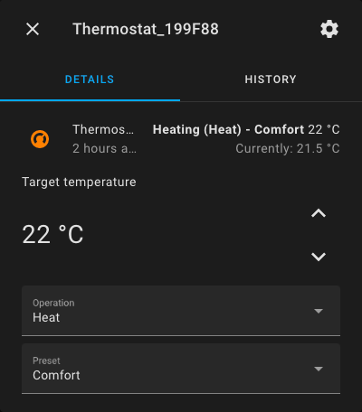

# Scinan Saswell Thermostat for Home Assistant

Control Saswell (Scinan) Wi-Fi thermostats locally, or through the Saswell cloud.

## Supported devices

Thermostats that use a Saswell "Thermostat" app, for example:

- Saswell SAS920FHL-7W-WIFI (electric floor heating)
- Saswell SAS922WHL-7W-S-WIFI (water floor heating)
- T13FHL-7(EN) WIFI (electric floor heating)
- Prosmart PST50W

The thermostat must already be on your Wi-Fi. Set it up with the Thermostat app.

## Local or cloud

| | Local (recommended) | Cloud |
|---|---|---|
| Adds | One thermostat, by IP address | All thermostats on your app account |
| Updates | Instant | Every 5 minutes |
| Needs internet | No | Yes |

- Local needs TCP port 2000 open from Home Assistant to the thermostat. Give it a fixed IP in your router.
- The phone app keeps working alongside.
- The Saswell cloud only uses plain HTTP (no encryption).

## Installation

**Marketplace:** `Settings -> Marketplace`, search for **Scinan Saswell Thermostat**, select **Install**, and
restart Home Assistant.

**HACS** (older Home Assistant versions): open HACS, search for **Scinan Saswell Thermostat**, select
**Download**, and restart Home Assistant.

**Manual:** copy `custom_components/scinan_thermostat` from the
[latest release](https://github.com/Skarbo/hass-scinan-thermostat/releases) into your `custom_components`
folder, and restart Home Assistant.

## Setup

`Settings -> Devices & services -> Add integration -> Scinan Saswell Thermostat`, then choose:

- **Local:** enter the thermostat's IP address. Repeat for each thermostat.
- **Cloud:** enter the email and password of your Thermostat app account.

Use **Reconfigure** on an entry to change the IP address (local) or the password (cloud).

### Moving from cloud to local

Open the cloud entry's options and choose **Move thermostats to local control** (a Repairs notice also
offers it). Enter the IP address of each thermostat you want to move. Names, areas, entity IDs and history
are kept.

## Features

- Target temperature (0.5 °C steps)
- HVAC mode: Heat / Off
- Presets: Auto / Away / Comfort / Day or night

Good to know:

- **Off** sets **Away** (5 °C) on electric floor heating thermostats (SAS920FHL, T13FHL), because they ignore
  the power command. Water floor heating thermostats turn off.
- Setting a temperature ends Away.
- **Auto** follows the thermostat's own schedule.
- Heating/idle is estimated (current temperature below target). The thermostat doesn't report it.
- Changing the thermostat's schedule isn't supported. Use a scheduler (for example
  [scheduler-card](https://github.com/nielsfaber/scheduler-card)) with the Comfort preset.

## Troubleshooting

**Local entity unavailable:** check that Home Assistant can reach the IP on port 2000, and that the IP hasn't
changed. After a power cut the thermostat reconnects by itself.

**Thermostat gone from the app after changing its Wi-Fi:** it still works. Add it as Local with its new IP
address. Redoing the setup in the app with the phone online may bring it back to the app.

**Cloud login problems:** check that the account works in the Thermostat app, then use **Reconfigure** to
enter the password again.

Still stuck? Check the logs and open an [issue](https://github.com/Skarbo/hass-scinan-thermostat/issues).

## Removing

Delete the entries in `Settings -> Devices & services -> Scinan Saswell Thermostat`. When you delete the last
one, Home Assistant offers to uninstall the files too.

## Changes

### v2.0.0

- Local control with instant updates.
- Move thermostats from cloud to local, keeping names and history.
- Reconfigure for IP address and cloud password.
- Support for the T13FHL-7(EN) WIFI (device type 3). Thanks to jsvdmeer.
- Removed the old Scinan v1.0 API. Old entries move to the Saswell v2.0 API automatically.
- Requires Home Assistant 2025.2 or newer.
- License changed from GPL-3.0 to MIT (earlier versions stay GPL-3.0).

### v1.1.0

Switched to the Saswell v2.0 API, which the Thermostat apps use since April 2023.

## Inspiration

- [com.scinan.api](https://github.com/PetterRuud/com.scinan.api/) (Homey)
- [node-red-contrib-scinan](https://github.com/lodegaard/node-red-contrib-scinan) (Node-RED)
- [HAExtra](https://github.com/hdcola/HAExtra/blob/master/custom_components/climate/saswell.py) (Saswell climate)
- [Mill](https://github.com/home-assistant/core/tree/dev/homeassistant/components/mill) (Home Assistant)

## License

[MIT](LICENSE)
